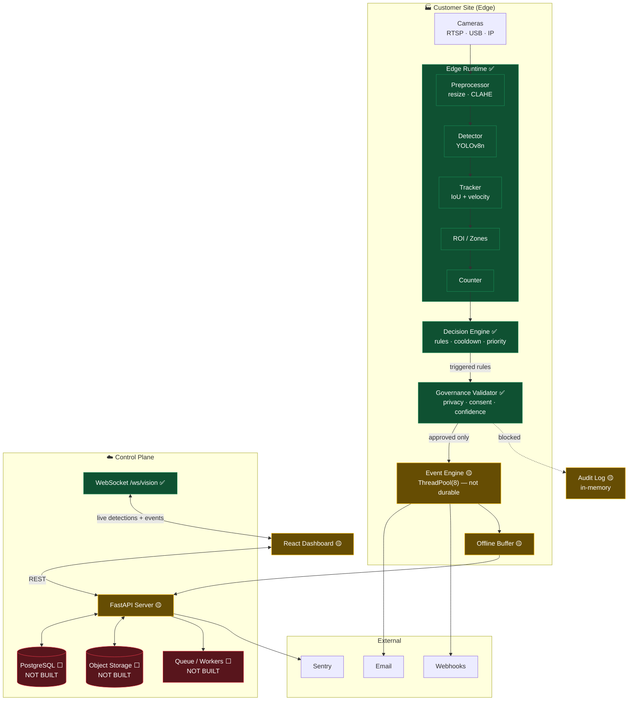
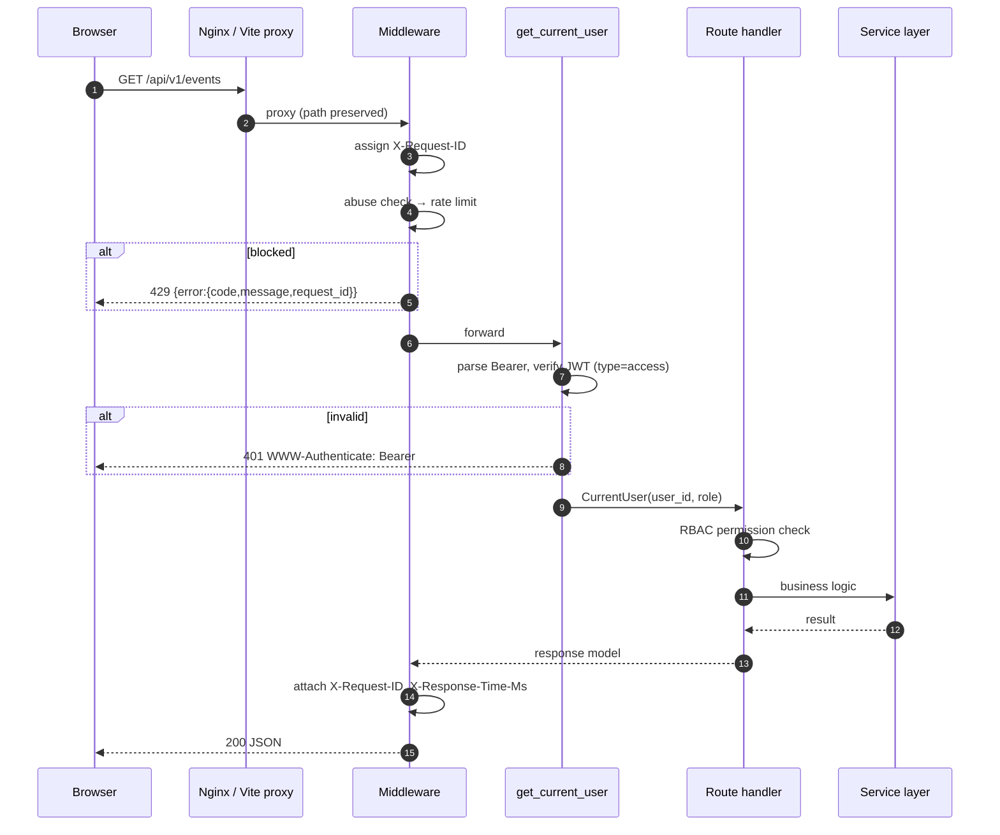
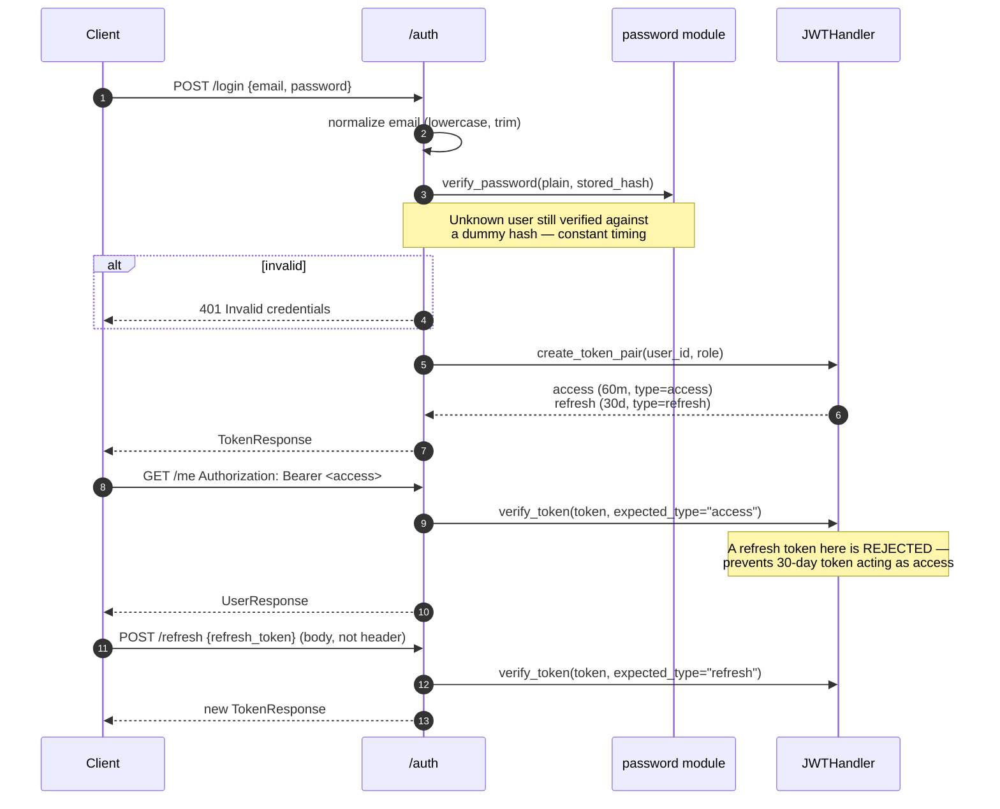
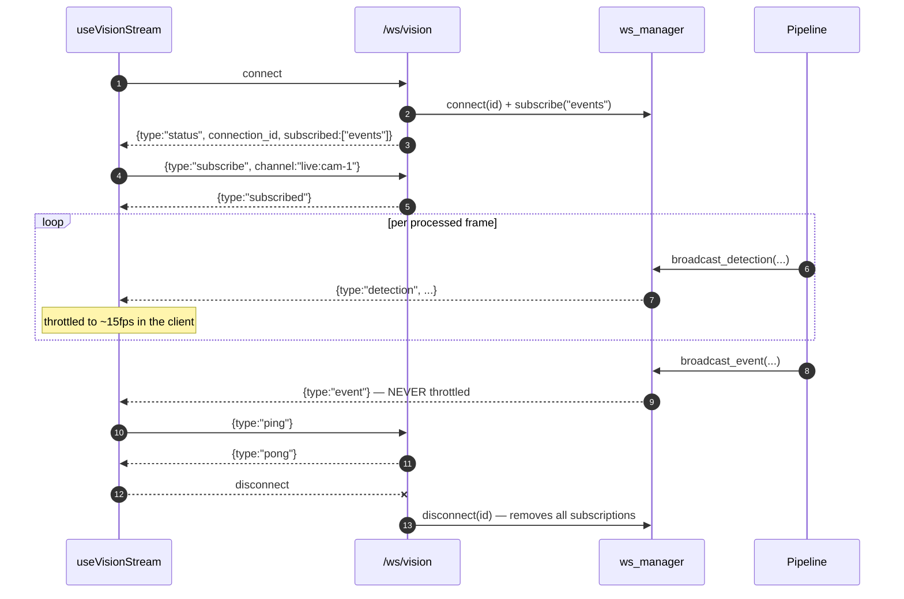
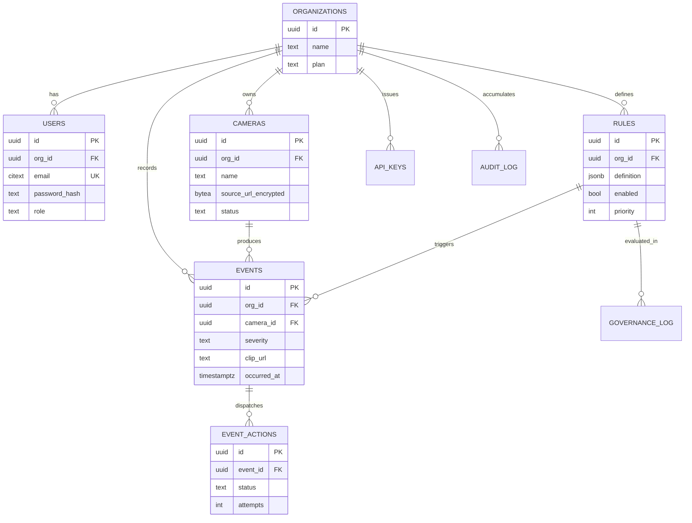
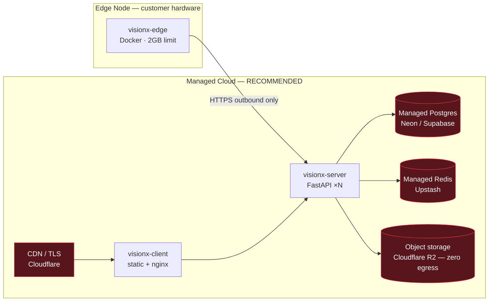
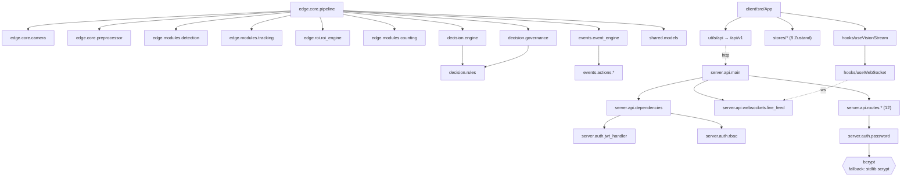
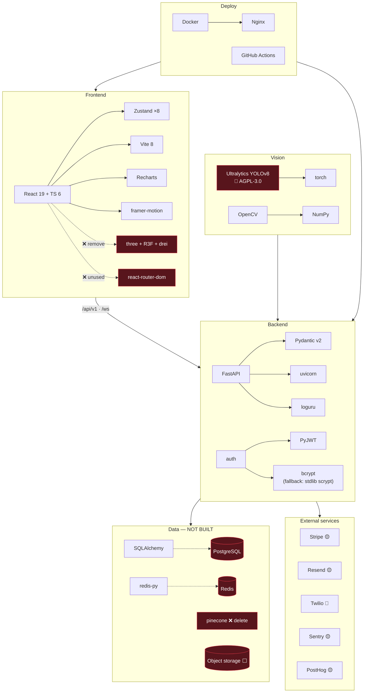

# VisionX — Master Blueprint

> **The single source of truth for this repository.** Start here.
> Last reconciled against code: **2026-08-02**

---

## ⚠️ Read This First — Status Honesty Contract

This document describes **what exists**, not what is planned. It exists because the
repository previously suffered severe documentation drift: the README marked
"Phases 1–7 ✅ Complete" while five API routers were unmounted, the WebSocket
endpoint did not exist, and nothing persisted across a restart.

**Definition of "Done" in this project — all three must hold:**

1. **Reachable** — invocable from the UI or a mounted API route
2. **Durable** — survives a process restart
3. **Tested** — covered by a test that exercises it through its real interface

Anything failing one of these is 🟡 *Partial* or ⬜ *Not built*, regardless of how much
code exists for it. Status legend used throughout:

| Symbol | Meaning |
|---|---|
| ✅ | Done — reachable, durable, tested |
| 🟡 | Partial — code exists, one or more gates unmet |
| ⬜ | Not built |
| 🔵 | Deliberately deferred |
| ❌ | Recommended for deletion (see `ENGINEERING_REVIEW.md` §17) |

**Companion documents:**

| Document | Role |
|---|---|
| `MASTER_BLUEPRINT.md` (this) | Navigation hub · architecture · current reality |
| `ENGINEERING_REVIEW.md` | Independent buildability/viability audit. Verdict: 🟠 Requires Major Redesign |
| `implementation_plan.md` | ⚠️ **Non-binding long-term vision.** 4,543 lines, ~72 sections. Sections §51–§72 have **zero** implementation. Do not treat as a work queue |
| `README.md` | Public-facing overview and quick start |

---

# Executive Summary

## Mission
Turn passive camera footage into automatic, trustworthy action — so nobody has to watch a screen to know something happened.

## Vision
A vision layer that runs anywhere (Raspberry Pi to cloud GPU), understands what it sees, decides whether it matters, checks that acting is *permitted*, and then acts.

## Problem Statement
**[FACT]** Organizations run cameras they cannot watch. Incidents are discovered hours later by manually scrubbing video. Existing analytics either (a) live on the camera and only do primitive line-crossing, (b) require replacing all hardware, or (c) generate so many false alerts they get switched off.

## Target Audience
**[GAP — M1]** No ICP is defined anywhere in this repository. The Engineering Review recommends a single vertical beachhead; **warehouse/industrial safety-zone monitoring** is the default recommendation pending customer research. *This is the highest-priority open product decision.*

## Core Value Proposition
> Detect → Understand → **Decide** → **Govern** → Act, on cameras you already own.

## Competitive Advantage

| Asset | Defensibility |
|---|---|
| **Governance gate** — a blocking privacy/ethics layer between decision and action | **Genuine.** No mainstream competitor ships this. Convertible into a compliance-led position |
| Rule engine with cooldowns, priority, and mutual-exclusion groups | Moderate — reflects real understanding of why alerting products get churned |
| Edge-first architecture (~96% gross margin, see §Cost) | Structural, if held to |
| Offline-first durable buffering | Moderate — sites lose connectivity constantly |

**Honest counterweight:** the market is crowded (Verkada, Spot AI, Coram, Solink) and **Frigate** is free, excellent, and open-source. See `ENGINEERING_REVIEW.md` §1.

## Business Model
**[GAP — M2]** No pricing artifact exists. Recommended: **per-camera/month subscription**, $10–20/camera, 4-camera minimum.

## One-Minute Explanation
> You already have cameras. They record, but nobody watches them. VisionX connects to those cameras, runs AI on-site to detect what matters — a person in a restricted zone, a forklift in a pedestrian aisle — checks the action against your privacy policy, and then does something: emails you, hits a webhook, saves a 10-second clip. Rules are built in a UI, not code. Because inference runs on-site, we don't stream your video to the cloud — which keeps it private and keeps our costs near zero.

---

# Product Overview

## User Personas

| Persona | Role | Goal | Frustration | Tech level |
|---|---|---|---|---|
| **Ops Manager (primary buyer)** | Facilities / warehouse ops | Know within a minute when a safety rule is broken | Drowns in false alerts; can't watch 40 feeds | Low |
| **Security Lead** | Site security | Find the clip proving what happened | Scrubbing hours of footage | Medium |
| **IT Admin (gatekeeper)** | Installs & integrates | Get it working without opening firewall holes | RTSP/ONVIF hell, vendor lock-in | High |
| **Compliance Officer** | Legal / HR | Prove no biometric processing occurs | Camera AI is a legal minefield | Low |

## Primary Use Cases

| # | Use case | Status |
|---|---|---|
| U1 | Person enters a restricted zone → alert + clip | 🟡 detection/rules work; clip storage ⬜ |
| U2 | Occupancy exceeds threshold → notify | 🟡 |
| U3 | Vehicle/forklift in pedestrian aisle → alarm | 🟡 |
| U4 | After-hours motion → escalate | ⬜ needs time-window rules |
| U5 | Review timeline of what happened | ⬜ needs persistence |

## Core Workflows

1. **Setup** — add camera → draw zones → pick rule template → test
2. **Daily** — glance at dashboard; receive alerts by email/webhook
3. **Investigate** — open event → watch clip → mark correct/incorrect
4. **Tune** — adjust thresholds from false-positive feedback

## Pain Points Solved

| Pain | How |
|---|---|
| Nobody watches the feeds | Rules watch continuously; humans only see exceptions |
| Alert fatigue | Cooldowns + priority + mutual-exclusion groups (`decision/engine.py`) |
| Privacy/legal risk | Governance gate blocks disallowed actions before they execute |
| Cloud video cost & exposure | Edge inference; only clips leave the site |
| Connectivity loss | Offline buffer with outbox pattern |

## Key Differentiators
Governance-gated actions · edge-first economics · rules that don't spam · works with existing cameras.

## Expected User Journey
`Land → Sign up → Add camera (⚠️ highest-risk step) → Draw zone → Pick template → First correct alert (the "aha") → Invite teammate → Add cameras → Upgrade`

**[FACT]** Landing page, signup UI, and camera-add UX do not exist. **[REC]** *First correct alert within 10 minutes of signup* is the activation metric to optimize.

---

# High-Level System Architecture

## Layer map & why each exists

| Layer | Why it exists | Status |
|---|---|---|
| **Edge Runtime** | Inference must be near the camera — bandwidth, latency, privacy, and COGS all demand it | ✅ |
| **Decision Engine** | Detections are noise; rules turn them into meaning | ✅ |
| **Governance Validator** | Legal/ethical constraints must be enforced *mechanically*, not by policy documents | ✅ |
| **Event Engine** | Decouples "something happened" from "what we do about it" | 🟡 no durability |
| **Sync Layer** | Sites lose connectivity; events must not be lost | 🟡 interface only |
| **API Server** | Control plane: auth, config, history | 🟡 no persistence |
| **Real-time Transport** | Live view + instant alerts in the browser | ✅ *(wired 2026-08-02)* |
| **Web Client** | Where humans configure and investigate | 🟡 backend gaps |
| **Persistence** | Nothing is a product if it vanishes on restart | ⬜ **critical gap** |
| **Object Storage** | The clip *is* the evidence | ⬜ **critical gap** |
| **Queue/Workers** | Alerts must survive process death | ⬜ **critical gap** |
| Caching (Redis) | Not needed until load exists | 🔵 |
| Search | Postgres FTS will suffice for years | 🔵 |
| Payments | Manual invoicing until ~10 customers | 🟡 code exists, deferred |
| Notifications | Email + webhook cover 90% of demand | 🟡 |
| Analytics/Monitoring | Sentry + PostHog wired, unverified | 🟡 |

---

# Architecture Diagrams

## System architecture



## Request flow — authenticated REST call



## Authentication flow



## WebSocket lifecycle



## Recommended database relationships (⬜ not yet built)



## Deployment topology



> **[REC]** `docker/docker-compose.yml` is excellent for **local development** and a
> liability as a **production topology**. A small team must not self-host Postgres.

## Service dependency graph



---

# Request Lifecycle

**Two distinct paths.** Confusing them is the most common onboarding mistake.

## Path A — Vision pipeline (hot, ~30 fps, no HTTP)

| # | Stage | Code | Budget |
|---|---|---|---|
| 1 | Frame capture | `edge/core/camera.py` | ~1 ms |
| 2 | Preprocess (resize/CLAHE) | `edge/core/preprocessor.py` | ~2 ms |
| 3 | Inference (YOLOv8n) | `edge/modules/detection.py` | 5–15 ms CPU |
| 4 | Rescale boxes to original frame | `pipeline.py:_scale_detections` | <1 ms |
| 5 | Track (IoU + velocity) | `edge/core/tracker.py` | ~1 ms |
| 6 | ROI filter | `edge/roi/roi_engine.py` | <1 ms |
| 7 | Count | `edge/modules/counting.py` | <1 ms |
| 8 | **Rule evaluation** | `decision/engine.py` | <1 ms |
| 9 | **Governance gate** | `decision/governance.py` | <1 ms |
| 10 | Event dispatch (async, off-thread) | `events/event_engine.py` | non-blocking |
| 11 | Broadcast to subscribers | `ws_manager.broadcast_detection` | non-blocking |

**Invariant:** steps 1–9 are synchronous and must fit the frame budget. Anything
that can block (network, disk, email) belongs in step 10 or later.

**🟡 Partial:** step 10 retries a failed action 3× with exponential backoff and
then **dead-letters** it rather than dropping it (`event_engine.py`). The queue
is an in-memory `deque(maxlen=500)`, so a process restart still loses every
pending retry and every dead letter, and nothing exposes the queue to an
operator. *Durable delivery remains the most dangerous open defect* — tracked as
DEF-022 / DEF-023 in [EXECUTION_TRACKER.md](EXECUTION_TRACKER.md).

## Path B — API request (cold, per user action)

Middleware (request ID → abuse → rate limit) → `Depends(get_current_user)` →
RBAC → handler → service → response + `X-Request-ID` + `X-Response-Time-Ms`.

**AI processing:** none. No LLM is involved in Path B. **Caching:** none yet — correct at this stage.

---

# Data Flow

```mermaid
flowchart LR
    subgraph CREATE["1 · Create"]
        F["Frame"] --> D["Detection<br/>(pydantic)"]
    end
    subgraph VALIDATE["2 · Validate"]
        D --> C["Confidence gate"]
        C --> G["Governance policies"]
    end
    subgraph PROCESS["3 · Process"]
        G --> E["Event"]
        E --> A["Actions"]
    end
    subgraph STORE["4 · Store"]
        E -.->|⬜ NOT BUILT| DB[("events table")]
        E -.->|⬜ NOT BUILT| CLIP[("clip → object storage")]
        E -->|🟡 in-memory, 1000 cap| MEM["event_history"]
    end
    subgraph SYNC["5 · Sync"]
        A --> OB["Outbox 🟡"]
        OB -.->|_push_to_cloud() returns True<br/>⬜ never hits network| API["Cloud API"]
    end
    subgraph RETRIEVE["6 · Retrieve"]
        API --> UI["Dashboard"]
        MEM --> WSB["WebSocket ✅"] --> UI
    end

    classDef missing fill:#58151c,stroke:#dc3545,color:#fff
    class DB,CLIP,API missing
```

| Stage | Mechanism | Status |
|---|---|---|
| Creation | Pydantic models (`shared/models.py`) | ✅ |
| Validation | Pydantic + governance policies | ✅ |
| Storage | In-memory lists, capped at 1000 | 🟡 **volatile** |
| Processing | Sync pipeline + threadpool actions | 🟡 retry + DLQ, but in-memory |
| Retrieval | REST + WebSocket | 🟡 |
| Caching | None | 🔵 correct for now |
| Deletion | GDPR endpoints exist; nothing to delete | 🟡 |
| Synchronization | Outbox pattern designed, transport stubbed | 🟡 |
| Backups | None | ⬜ |

---

# Folder Structure

```
VISIONX/
├── edge/                      # Edge runtime — runs at the customer site
│   ├── core/                  #   pipeline · camera · tracker · preprocessor · threading
│   ├── modules/               #   detection · tracking · counting · heatmap · measurement
│   ├── roi/                   #   zone definition & filtering
│   └── config/                #   Lite / Balanced / Max performance profiles
│
├── decision/                  # ✅ Rule evaluation + governance gate (best code in repo)
│   ├── engine.py              #   priority · cooldown · mutual-exclusion groups
│   ├── governance.py          #   privacy · consent · confidence · severity cap
│   └── rules.py               #   Rule / Condition / Operator / Severity models
│
├── events/                    # Event dispatch (the "act" in detect→act)
│   ├── event_engine.py        #   bounded ThreadPoolExecutor(8)
│   ├── actions/               #   log · webhook · email · api · iot · hardware · alarm …
│   └── templates/             #   pre-built rule bundles
│
├── cloud/                     # Heavier, optional AI modules
│   ├── modules/               #   ❌ face · pose · segmentation · behavior · speed (see review §17)
│   ├── analytics/             #   aggregation engine
│   └── ai/model_manager.py    #   ❌ hot-swap infra for one static model
│
├── sync/                      # 🟡 Edge ↔ cloud sync (outbox designed, transport stubbed)
│
├── server/                    # Control plane (FastAPI)
│   ├── api/
│   │   ├── main.py            #   app · middleware · /ws/vision · router mounting
│   │   ├── dependencies.py    #   ✅ get_current_user · require_permission (USE THESE)
│   │   ├── routes/            #   12 routers, all mounted
│   │   ├── middleware/        #   cors · rate_limiter · abuse_detector
│   │   └── websockets/        #   ConnectionManager (channel pub/sub)
│   ├── auth/                  #   password ✅ · jwt_handler ✅ · rbac · oauth
│   ├── db/                    #   ⬜ connection stubs only — NO SCHEMA
│   ├── billing/ notifications/ admin/ observability/ help/ crash_reporting/
│
├── client/src/                # React 19 + Vite 8 + TypeScript
│   ├── pages/                 #   7 pages
│   ├── components/
│   │   ├── 3d/                #   ❌ Three.js characters — recommended for deletion
│   │   ├── ui/ monitoring/ config/ analytics/ …
│   ├── stores/                #   8 Zustand stores
│   ├── hooks/                 #   9 hooks (useVisionStream is the WS bridge)
│   └── utils/api.ts           #   same-origin /api/v1 client
│
├── shared/                    # Cross-cutting pydantic models & constants
├── visualization/             # OpenCV overlay rendering
├── tests/                     # 191 tests
├── docker/                    # 3 Dockerfiles · compose · nginx
└── .github/workflows/ci.yml   # lint · test · typecheck · build · audit
```

## Conventions

| Aspect | Convention |
|---|---|
| Python modules/files | `snake_case` |
| Python classes | `PascalCase` |
| Private members | `_leading_underscore` |
| Pydantic models | `PascalCase`, suffixed `Request` / `Response` / `Result` |
| React components | `PascalCase.tsx` |
| Hooks | `useThing.ts` |
| Zustand stores | `thingStore.ts` |
| API routes | plural nouns, kebab-case: `/api/v1/events` |
| Imports | `from __future__ import annotations` first in every Python module |
| Optional deps | wrap in `try/except ImportError` with a graceful fallback |

## Ownership

**[GAP]** No `CODEOWNERS` file exists. **[REC]** With ≤3 engineers, assign by layer:
edge/decision · server/platform · client.

---

# Component Registry

| Component | Purpose | Technology | Depends on | Consumed by | Priority | Status |
|---|---|---|---|---|---|---|
| `edge.core.pipeline` | Orchestrates the vision loop | Python, OpenCV | camera, detector, tracker, decision, governance, events | Edge runtime | P0 | ✅ |
| `edge.core.camera` | Frame source (USB/RTSP/IP) | OpenCV | — | pipeline | P0 | 🟡 needs reconnect hardening |
| `edge.modules.detection` | Object detection | YOLOv8n | ultralytics | pipeline | P0 | ✅ |
| `edge.core.tracker` | Multi-object tracking | IoU + velocity | — | pipeline | P0 | ✅ |
| `edge.roi.roi_engine` | Zone definition/filtering | Python | shared.models | pipeline | P0 | ✅ |
| `decision.engine` | Rule evaluation | Python | decision.rules | pipeline, API | P0 | ✅ |
| `decision.governance` | Privacy/ethics gate | Pydantic | decision.rules | pipeline | P0 | ✅ |
| `events.event_engine` | Action dispatch | ThreadPoolExecutor | decision.rules | pipeline | P0 | 🟡 not durable |
| `events.actions.*` | 10 action implementations | httpx, smtplib | event_engine | pipeline | P1 | 🟡 6 ❌ recommended for removal |
| `sync.sync_engine` | Edge↔cloud outbox | asyncio | — | edge | P1 | 🟡 transport stubbed |
| `server.api.main` | HTTP + WS entry point | FastAPI | routes, ws_manager, middleware | all clients | P0 | ✅ |
| `server.api.dependencies` | Auth/RBAC injection | FastAPI DI | jwt_handler, rbac | all routes | P0 | ✅ |
| `server.auth.password` | Credential hashing | bcrypt / scrypt | — | auth routes | P0 | ✅ |
| `server.auth.jwt_handler` | Token issue/verify | PyJWT | — | dependencies | P0 | ✅ |
| `server.auth.rbac` | Role→permission map | Python | — | dependencies | P1 | 🟡 enforcement available, not applied to every route |
| `server.api.websockets.live_feed` | Channel pub/sub | Starlette WS | — | main, pipeline | P0 | ✅ |
| `server.db.postgres` | DB connection | SQLAlchemy | asyncpg | — | **P0** | ⬜ **no schema** |
| `server.db.pinecone_client` | Vector store | Pinecone | — | nothing | — | ❌ delete |
| `client/App.tsx` | Shell + routing | React 19 | stores, hooks | browser | P0 | ✅ |
| `client/hooks/useVisionStream` | WS→store bridge | React | useWebSocket | App | P0 | ✅ |
| `client/stores/*` | Client state (8) | Zustand | — | components | P0 | ✅ |
| `client/components/3d/*` | 3D characters | Three.js, R3F | — | Dashboard | — | ❌ delete |

---

# Feature Registry

| Feature | User value | Depends on | Cplx | Status | Version |
|---|---|---|---|---|---|
| Object detection | Sees what's there | YOLOv8 | M | ✅ | V1 |
| Multi-object tracking | Distinguishes individuals over time | detection | M | ✅ | V1 |
| Zones / ROI | "Only care about this area" | tracking | L | ✅ | V1 |
| Counting | Occupancy limits | ROI | L | ✅ | V1 |
| Rule engine | Turns detections into decisions | — | M | ✅ | V1 |
| Cooldowns / priority / groups | Prevents alert flooding | rules | L | ✅ | V1 |
| Governance gate | Legal/privacy safety | rules | M | ✅ | V1 |
| Email + webhook actions | Delivers the alert | events | L | 🟡 retry, not durable | V1 |
| **Live WebSocket feed** | Trust: "it's working" | ws_manager | M | ✅ | V1 |
| Auth (hashed, JWT) | Account security | password, jwt | M | ✅ | V1 |
| RBAC | Least privilege | auth | L | 🟡 | V1 |
| **Event persistence** | History survives restart | Postgres | H | ⬜ | **V1** |
| **Multi-tenancy (`org_id`)** | Required to be a SaaS | Postgres | H | ⬜ | **V1** |
| **Clip capture → storage** | The evidence | object storage | H | ⬜ | **V1** |
| **Durable action outbox** | Alerts never silently lost | queue | M | ⬜ | **V1** |
| **False-positive feedback** | The data moat | events | L | ⬜ | **V1** |
| Camera onboarding UX | Activation | API | H | ⬜ | **V1** |
| Landing page + signup | Acquisition | — | M | ⬜ | **V1** |
| Rule builder UI | Self-serve config | API | M | ✅ | V1 |
| Analytics dashboard | Trends | events | M | 🟡 | V2 |
| Heatmaps | Traffic patterns | detection | L | 🟡 | V2 |
| Multi-camera | Scale per site | pipeline | H | 🟡 | V2 |
| Stripe billing | Revenue | auth, DB | M | 🟡 | V2 |
| Slack/Teams | Where teams live | webhooks | L | ⬜ | V2 |
| OAuth / SSO | Enterprise entry | auth | M | 🟡 | V3 |
| LPR / OCR | Vehicle workflows | cloud | M | 🟡 | V3 |
| Face recognition | — | cloud | H | ❌ | **Never** (BIPA) |
| Cross-camera re-ID | — | tracking | VH | ❌ | Future |
| Behavior / pose / segmentation | — | cloud | VH | ❌ | Never |
| 3D AI characters | — | Three.js | H | ❌ | Never |

---

# API Overview

**Base:** `/api/v1` · **Auth:** `Authorization: Bearer <access_token>` · **Docs:** `/docs`, `/redoc`

| Group | Prefix | Purpose | Status |
|---|---|---|---|
| System | `/`, `/health` | Identity, probes | ✅ |
| Authentication | `/api/v1/auth` | login · register · me · refresh | ✅ |
| Vision | `/api/v1/vision` | pipeline status · modules · rules | 🟡 |
| Events | `/api/v1/events` | event history | 🟡 volatile |
| Devices | `/api/v1/devices` | device registry | 🟡 |
| Analytics | `/api/v1/analytics` | aggregates | 🟡 |
| Admin | `/api/v1/admin` | health · users · stats | 🟡 |
| GDPR | `/api/v1/gdpr*` | export · erase · consent | 🟡 |
| Billing | `/api/v1/billing` | plans · subscription | 🟡 *(mounted 2026-08-02)* |
| Config | `/api/v1/config` | remote config | 🟡 *(mounted)* |
| Help | `/api/v1/help` | articles · tickets | ❌ *(mounted; recommended for deletion)* |
| Notifications | `/api/v1/notifications` | prefs · channels | 🟡 *(mounted)* |
| Usage | `/api/v1/usage` | metering | 🟡 *(mounted)* |
| **WebSocket** | `/ws/vision` | live detections + events | ✅ *(built 2026-08-02)* |

## Cross-cutting behaviour

| Concern | Implementation |
|---|---|
| **Versioning** | URL prefix `/api/v1`. Breaking changes ⇒ `/api/v2` |
| **Auth** | `Depends(get_current_user)` — never parse the header in a handler |
| **Authorization** | `Depends(require_permission(Permission.X))` |
| **Token types** | `access` (60 min) and `refresh` (30 d) are **not** interchangeable |
| **Error envelope** | `{"error": {"code", "message", "request_id"}}` |
| **Request tracing** | `X-Request-ID` accepted or generated; echoed on every response |
| **Rate limits** | 60/min, 1000/hr per IP. `/health`, `/`, `/docs`, `/openapi.json` exempt |
| **Rate-limit headers** | `X-RateLimit-{Limit,Remaining}-{Minute,Hour}` |
| **Pagination** | ⬜ **Not implemented.** [REC] cursor-based before events table grows |
| **Idempotency** | ⬜ Not implemented — required for ingestion |
| **Outbound webhooks** | 🟡 No HMAC signing, no retry — [REC] before customers trust them |

## WebSocket protocol

**Client → server:** `{"type":"subscribe"|"unsubscribe","channel":"live:<cam>"}`, `{"type":"ping"}`
**Server → client:** `status` · `subscribed` · `unsubscribed` · `detection` · `event` · `pong` · `error`

Clients are auto-subscribed to `events` on connect. Detections are throttled
client-side to ~15 fps; **events are never throttled**.

---

# Database Overview

**Choice:** PostgreSQL — relational integrity, JSONB for variable rule/metadata shapes, mature partitioning, and Row-Level Security for tenant isolation.

**⚠️ [FACT] No schema exists.** `server/db/postgres.py` builds an async engine and stops. Everything below is the recommended design.

| Concern | Recommendation | Rationale |
|---|---|---|
| **Tenancy** | `org_id` on every table + **Postgres RLS** | Makes tenant leakage a DB-enforced invariant, not a code-review one |
| **Tables (V1)** | 9 (see ER diagram) | Nine, not ninety |
| **Hot table** | `events`, partitioned **monthly** from day one | Retroactive partitioning of a live table is painful |
| **Indexes** | `events(org_id, occurred_at DESC)`, `events(org_id, camera_id, occurred_at DESC)`, `cameras(org_id)`, `users(email)` | Covers every V1 query. Add more only when `pg_stat_statements` says so |
| **JSONB** | `rules.definition`, `events.metadata` only | Correct for genuinely variable shapes; never JSONB what you filter on |
| **Migrations** | **Alembic from the first table** | Non-negotiable |
| **Backups** | Managed Postgres with PITR | Do not self-host |
| **Never store** | Per-frame detections | Aggregate at the edge; persist only rule-triggered events |
| **Retention** | 90-day default, org-configurable | Cost and GDPR minimization |

---

# Infrastructure Overview

| Concern | Current | Recommended |
|---|---|---|
| Hosting | ⬜ undecided | Fly.io / Railway / Render |
| Cloud provider | ⬜ undecided **[GAP M6]** | Provider-agnostic containers |
| Containers | ✅ 3 Dockerfiles + compose | Keep for dev |
| CI | ✅ lint · test · typecheck · build · audit | Add coverage gate |
| **CD** | ⬜ builds images, deploys nowhere | Deploy on green `main` |
| CDN | ⬜ | Cloudflare |
| Object storage | ⬜ **blocking** | **Cloudflare R2 (zero egress)** |
| Caching | 🟡 Redis in compose, unused | Upstash when needed |
| Queues | ⬜ **blocking** | Postgres-backed outbox (simplest that works) |
| Secrets | 🟡 env vars | Platform secret store |
| Environments | ⬜ one | dev · staging · prod |
| Monitoring | 🟡 Sentry wired, unverified | Verify with a real DSN |
| Logging | 🟡 Loguru, unstructured | JSON sink + `request_id` |
| Tracing | ⬜ | 🔵 defer |
| Alerting | ⬜ | Uptime check → phone |
| Backups | ⬜ | Managed PITR |
| DR | ⬜ documented only | RPO 24h / RTO 4h is honest for V1 |

## Cost model (the decision that determines the business)

| Architecture | COGS/camera/mo | Margin @ $10/cam |
|---|---|---|
| ❌ Cloud relay (GPU + storage + egress) | **$44 – $53** | **Negative** |
| ✅ **Edge inference + clips only** | **≈ $0.35** | **~96%** |

Fixed stack at V1 scale: **$55–$276/mo**. Full derivation in `ENGINEERING_REVIEW.md` §10.

---

# Security Overview

| Control | Status | Notes |
|---|---|---|
| Password hashing | ✅ | bcrypt (cost 12) with SHA-256 pre-hash; stdlib scrypt fallback. Self-describing hashes support lazy migration |
| Timing-safe login | ✅ | Unknown emails verified against a dummy hash |
| JWT signing | ✅ | **Fails closed in production** — missing/weak/default secret raises at startup |
| Token type separation | ✅ | Refresh tokens rejected where access tokens are required |
| Token revocation | 🟡 | In-memory JTI set; lost on restart |
| Auth injection | ✅ | Single `get_current_user` dependency |
| RBAC | 🟡 | `require_permission` available; not yet applied to every route |
| **Tenant isolation** | ⬜ | **No `org_id` exists** |
| Rate limiting | 🟡 | Per-process; ineffective at >1 replica |
| Abuse detection | 🟡 | Same limitation |
| Transport security | 🟡 | TLS terminates at nginx/CDN |
| Secrets at rest | ⬜ | Camera RTSP credentials unencrypted |
| Audit logs | 🟡 | Governance audit in memory only |
| CSP / security headers | ✅ | `docker/nginx.conf`; `'unsafe-inline'` scripts is a known low-severity gap |
| SQL injection | 🟢 | No SQL yet; re-review when ORM lands |
| XSS | 🟢 | React escapes by default |
| CSRF | 🟡 | Token in `localStorage` is XSS-exfiltratable |
| SSRF | 🟡 | Webhook/RTSP URLs unvalidated — needs private-IP blocklist |
| Dependency audit | ✅ | `pip-audit` + `npm audit` in CI |

## Compliance posture

| Regime | Readiness | Note |
|---|---|---|
| GDPR | ~15% | Endpoints exist; nothing persists. DPIA (Art. 35) not started |
| **BIPA (Illinois)** | 🔴 | $1k–5k **per scan**, private right of action. **[REC] Ship without face recognition** |
| CCPA/CPRA | ~10% | Biometrics = sensitive PI |
| SOC 2 Type II | ~5% | 6–12 months, $30–60k. Only when a named deal requires it |
| EU AI Act | ⚠️ unassessed | Real-time biometric ID may be prohibited/high-risk |

> **[REC] Strategic:** removing face recognition converts the largest legal liability
> into the clearest differentiator — *"privacy-preserving by architecture."* The
> governance layer is the proof.

---

# AI Architecture

**This product uses computer vision, not LLMs.** There is no prompt, no RAG, no vector search in the runtime path.

| Aspect | Reality |
|---|---|
| Model | YOLOv8n (`yolov8n.pt`, 6.5 MB, **committed to git** — [REC] move to release artifact) |
| Prompt strategy | N/A |
| RAG / vector DB | **Unnecessary.** `server/db/pinecone_client.py` is unused — [REC] **delete** |
| Latency | 5–15 ms/frame CPU @320px; 2–4 ms GPU |
| Cost per inference | **$0** — runs on customer hardware |
| Fallback | Confidence gate (`min_confidence=0.4`) in governance |
| Hallucination / prompt injection | N/A |
| **Evaluation** | ⬜ **CRITICAL GAP** — no mAP/precision/recall harness, no labeled set, no FP tracking |
| Monitoring | ⬜ no detection-quality metrics in production |

> **The single most important AI finding:** false positives are the #1 churn cause in
> this category, and there is currently no way to measure them.
>
> **[REC] Before adding any model:** (1) labeled validation set from real footage,
> (2) precision/recall harness in CI, (3) in-UI "this alert was wrong" feedback —
> which is simultaneously your quality loop and your only durable data moat.

## ⚠️ Model licensing — unresolved commercial blocker

**[FACT]** Ultralytics YOLOv8 is **AGPL-3.0**. This repository is **MIT**. Commercial
SaaS use requires either an Ultralytics commercial licence or migration to a
permissively-licensed detector. **No document in this repo acknowledges this.**
Must be resolved before revenue.

---

# Technology Stack

| Technology | Purpose | Why chosen | Alternatives | Tradeoff |
|---|---|---|---|---|
| **Python 3.11+** | Backend + vision | Only serious CV ecosystem | Go, Rust | Slower; irrelevant when OpenCV/CUDA do the work |
| **FastAPI** | HTTP + WS | Async, Pydantic-native, free OpenAPI | Flask, Django | Smaller ecosystem than Django |
| **Pydantic v2** | Validation | Rust core, fast, one model layer | dataclasses | v1→v2 migration cost |
| **YOLOv8n** | Detection | Best accuracy/speed at the edge | RT-DETR, YOLOX, MobileNet-SSD | 🔴 **AGPL-3.0** |
| **OpenCV** | Frame I/O | Universal | PyAV, GStreamer | RTSP handling is fragile |
| **Loguru** | Logging | Ergonomic | stdlib logging | Needs JSON sink for prod |
| **bcrypt** | Password hashing | Battle-tested, tunable cost | argon2 | Slower than argon2id; passlib is broken with bcrypt ≥4.1 |
| **PyJWT** | Tokens | Standard, minimal | authlib | Manual revocation handling |
| **PostgreSQL** | Persistence *(planned)* | JSONB + RLS + partitioning | MongoDB, SQLite | Ops weight ⇒ use managed |
| **React 19** | UI | Ecosystem, hiring | Vue, Svelte | Bundle size |
| **Vite 8** | Build | Fast HMR, good splitting | Next.js | No SSR (not needed) |
| **TypeScript 6** | Type safety | Catches contract drift | JS | Build step |
| **Zustand** | State | Tiny, no boilerplate | Redux, Jotai | Less tooling |
| **Three.js / R3F** | 3D characters | — | — | ❌ **Recommended for removal** |
| **Docker** | Packaging | Same artifact everywhere | Nix | Image size |
| **GitHub Actions** | CI | Free, integrated | CircleCI | Vendor coupling |

---

# Engineering Principles

## Architecture
1. **Edge-first.** Inference near the camera. Bandwidth, latency, privacy, and margin all agree.
2. **The hot path is sacred.** Nothing that can block belongs in the frame loop.
3. **Fail closed on security, fail open on features.** A missing JWT secret crashes; a missing optional module warns.
4. **Governance is mechanical.** Constraints are enforced by code, not documents.
5. **Every abstraction pays rent.** No layer without a current, named problem.

## Coding standards
- `from __future__ import annotations` first in every Python module
- Type hints on all public functions
- Docstrings explain **why**, not what
- Optional imports wrapped in `try/except ImportError` with graceful degradation
- Ruff clean: `ruff check . --select E,W,F --ignore E501`
- Frontend: `tsc --noEmit` clean

## Error handling
| Layer | Standard |
|---|---|
| Edge pipeline | Never crash on one bad frame — log and continue |
| Actions | Retry 3× with backoff, then dead-letter — **never silently drop** |
| API | `HTTPException` with the standard error envelope |
| Auth | Return `None`/401 — never leak *why* verification failed |
| WebSocket | One bad socket must never kill the server |

## Testing
| Level | Rule |
|---|---|
| Unit | Every rule/governance/tracking behaviour |
| **HTTP** | **Every mounted router must have a reachability test** — this is how five routers went missing |
| WebSocket | Protocol messages tested over real transport |
| Security | Every finding in the review gets a regression test |
| Bar | Ship only with the full suite green |

## Performance
Frame budget 33 ms @30 fps · API p95 <200 ms (uncached) · WS→UI throttled to 15 fps · events never throttled.

## Documentation
This blueprint is updated **in the same commit** as the change it describes. Docs claiming un-built features are treated as bugs.

---

# Design Decisions

| # | Decision | Reason | Alternatives | Tradeoff | Long-term impact |
|---|---|---|---|---|---|
| D1 | **Governance gate between decision and action** | Legal constraints must be mechanically enforced | Check inside each action; policy docs only | One more hop | **Primary differentiator**; potential standalone product |
| D2 | **Edge inference, not cloud** | Cloud relay = negative gross margin | Cloud GPU | Customer supplies hardware | Makes the business viable at all |
| D3 | **Rules as data (JSONB), not code** | Users configure without deploys | DSL; Python plugins | Less expressive | Enables self-serve |
| D4 | **Cooldowns + priority + groups in the engine** | Alert flooding is the #1 churn cause | Debounce in UI | More engine complexity | Directly protects retention |
| D5 | **bcrypt direct, drop passlib** | passlib 1.7.4 is **broken** with bcrypt ≥4.1 | Pin old bcrypt; argon2 | Manual scheme handling | Removes a broken dependency; scrypt fallback keeps CI honest |
| D6 | **JWT fails closed in production** | Fail-open default allowed forged admin tokens | Warn only | Deploy must set the env var | Converts silent auth bypass into a loud startup crash |
| D7 | **Access/refresh tokens not interchangeable** | A 30-day token acting as access defeats short expiry | Single token type | Slightly more client logic | Materially smaller stolen-token window |
| D8 | **Auth via FastAPI dependency** | Per-route header parsing guarantees an eventual miss | Middleware; decorators | Explicit on each route | Makes RBAC enforceable and testable |
| D9 | **Same-origin `/api/v1` + dev proxy** | Hardcoded `localhost:8000` breaks everywhere but one laptop | Env var per environment | Proxy config needed | One code path in dev and prod |
| D10 | **Zone-scoped governance policies** | Action-first ordering blocked biometrics globally and made the consent policy unreachable | Per-policy priority field | Slightly more logic | Correct privacy semantics |
| D11 | **`org_id` + RLS (planned)** | Tenant leakage should be a DB invariant | App-level filtering | RLS learning curve | Cheapest security insurance available |
| D12 | **Postgres-backed outbox, not Celery/Kafka** | Simplest thing that gives durability | Celery + Redis; SQS | Lower throughput ceiling | Removes an entire moving part at V1 scale |
| D13 | **Managed infrastructure** | A 3-person team cannot staff 3am WAL recovery | Self-hosted k8s | Higher unit cost | Buys back weeks of engineering |
| D14 | **Archive the 72-section plan as non-binding** | Made "done" unmeasurable; drove breadth over depth | Keep as roadmap | Loses the aspirational narrative | **Restores the ability to finish things** |

---

# Development Roadmap

## Current phase
**Phase 0 — Decide & Stabilize.** Critical security and reachability defects fixed (below). **Blocked on four product decisions.**

## Completed (verified 2026-08-02)

| Work | Evidence |
|---|---|
| Edge pipeline: camera → detect → track → ROI → count | `edge/`, tests green |
| Decision engine: priority, cooldown, mutual-exclusion | `decision/engine.py`, 11 tests |
| Governance validator + **zone-scoping fix** | `decision/governance.py`, 22 tests |
| Event engine with bounded threadpool | `events/event_engine.py` |
| React 19 dashboard, 8 stores, 9 hooks | `client/`, `tsc` clean, build green |
| **Password hashing (bcrypt/scrypt), timing-safe login** | `server/auth/password.py`, 13 tests |
| **JWT fails closed in production** | `server/auth/jwt_handler.py`, 6 tests |
| **Token type separation** | 4 tests |
| **`get_current_user` / `require_permission` DI** | `server/api/dependencies.py` |
| **All 12 routers mounted** (5 were unreachable) | `server/api/main.py`, parametrized guard test |
| **`/ws/vision` WebSocket endpoint** | `server/api/main.py`, 8 tests, verified over real socket |
| **Vite dev proxy + same-origin API base** | `vite.config.ts`, `utils/api.ts` |
| **nginx `proxy_pass` prefix-strip fix** | `docker/nginx.conf` |
| **Server entry point** (`platform.` → `server.`) | verified via uvicorn boot |
| **Request IDs + unified error envelope** | `server/api/main.py` |
| **Test suite 95 → 191** | `pytest -q` |
| **Action retry + dead-letter queue** | `events/event_engine.py`, `tests/test_events.py` |
| **`/api/v1/events` returns 501, not a fake empty result** | `tests/test_http.py` |
| **Defect tracker created** | [EXECUTION_TRACKER.md](EXECUTION_TRACKER.md) |

## In progress
Documentation reconciliation (this file, `ENGINEERING_REVIEW.md`, README).

## Remaining for V1 — ordered by dependency

| # | Work | Why blocking |
|---|---|---|
| 1 | **Answer M1/M3/M6/M8** (vertical · hardware · inference location · biometrics) | Product decisions that invalidate code either way |
| 2 | **Delete the 13 removal-flagged features** | Every one is maintenance drag on ≤3 engineers |
| 3 | **Postgres schema + Alembic + RLS** | Nothing is a product if it vanishes on restart |
| 4 | **`org_id` multi-tenancy** | Retrofitting later is a 6–10 week refactor |
| 5 | **Durable outbox + retry + DLQ** | Silently dropped alerts destroy trust permanently |
| 6 | **Object storage + clip capture** | The clip *is* the product |
| 7 | **Apply `require_permission` to every route** | RBAC exists but isn't enforced everywhere |
| 8 | **Camera onboarding UX** | The activation bottleneck |
| 9 | **False-positive feedback loop** | Quality loop + data moat |
| 10 | **Eval harness (precision/recall) in CI** | Cannot fix what you cannot measure |
| 11 | Landing page + signup + login UI | No acquisition surface exists |
| 12 | Pagination, idempotency, webhook HMAC | API hardening before customers |
| 13 | Structured JSON logs + alerting + backups | Operability |

## Milestones

| Milestone | Definition of done |
|---|---|
| **M-A: Durable** | Camera added via UI → rule fires → clip stored → email sent → **all survives restart** |
| **M-B: Unattended** | 3 cameras, 24h, no intervention, <1 false positive/camera/day |
| **M-C: Design partner** | ≥1 external user says *"don't turn this off"* |
| **M-D: First revenue** | Self-serve signup → payment → active |

## Technical debt register

| Debt | Severity | Plan |
|---|---|---|
| No persistence / no tenancy | 🔴 Critical | Remaining item #3–4 |
| Actions dropped on failure | 🔴 Critical | Item #5 |
| Ultralytics AGPL vs MIT repo | 🔴 Critical | Licence decision (M8-adjacent) |
| In-memory user store | 🟠 High | Folded into #3 |
| RBAC not applied to all routes | 🟠 High | Item #7 |
| Rate limiter per-process | 🟡 Medium | Redis before replica #2 |
| Token revocation in memory | 🟡 Medium | Redis/DB with #3 |
| 13 features flagged for deletion | 🟠 High | Item #2 |
| `implementation_plan.md` drift | 🟠 High | Archive as non-binding |
| `yolov8n.pt` in git | 🟢 Low | Move to release artifact |
| Unused `react-router-dom` | 🟢 Low | Remove |
| CSP `'unsafe-inline'` | 🟢 Low | Nonce-based CSP |

---

# Operational Readiness

**Verdict: 🔴 Not production ready.**

| Capability | Status | Minimum bar for launch |
|---|---|---|
| Health checks | ✅ | Extend to check Postgres/Redis once they exist |
| Logging | 🟡 | JSON + `request_id` correlation |
| Monitoring | 🟡 | Verify Sentry against a real DSN |
| Analytics | 🟡 | PostHog on activation funnel |
| Alerting | ⬜ | Uptime check → phone. **Non-negotiable for an alerting product** |
| Incident response | ⬜ | One page: who's called, how to roll back |
| Rollback | ⬜ | Redeploy previous image tag |
| Feature flags | ⬜ | 🔵 defer |
| Backups | ⬜ | Managed PITR |
| DR | ⬜ | RPO 24h / RTO 4h |
| Maintenance | ⬜ | Monthly dependency updates |
| Support | ⬜ | Crisp/Intercom — **do not build ticketing** |

---

# Risk Summary

| Risk | Rank | Mitigation |
|---|---|---|
| Ultralytics AGPL vs commercial SaaS | 🔴 Critical | Buy licence or migrate detector before revenue |
| BIPA/GDPR biometric exposure | 🔴 Critical | **Remove face recognition + re-ID** |
| No persistence / no tenancy | 🔴 Critical | V1 items #3–4 |
| Alerts dropped silently | 🔴 Critical | V1 item #5 |
| No ICP / pricing / customer evidence | 🔴 Critical | 20 interviews before more code |
| **Scope re-expansion toward the 72-section plan** | 🔴 Critical | Archive it as non-binding |
| Cloud-relay margin inversion | 🟠 High | Hold the edge-first line (D2) |
| False positives → month-2 churn | 🟠 High | Eval harness + feedback loop |
| RTSP/camera compatibility long tail | 🟠 High | Publish a supported-camera list |
| Frigate undercuts prosumer/SMB | 🟠 High | Sell to businesses, not hobbyists |
| 47 features / ≤3 engineers | 🟠 High | Delete 13 |
| Rate limiter per-process | 🟡 Medium | Redis before replica #2 |
| SSRF via user-supplied URLs | 🟡 Medium | Private-IP blocklist |
| Camera credentials unencrypted | 🟠 High | Encrypt at rest with the schema |
| Vendor lock-in (Stripe/Sentry) | 🟢 Low | Acceptable, swappable |

---

# Feasibility Summary

Full analysis: **`ENGINEERING_REVIEW.md`**. Verdict: **🟠 Requires Major Redesign** · Reality Score **41/100**.

| Category | Summary |
|---|---|
| **Removed (recommended)** | Face recognition · cross-camera re-ID · behavior/pose/segmentation/speed · model hot-swap · Pinecone · 3D characters · 5 themes · custom help desk · custom crash reporting · admin takeover · IoT/hardware/alarm actions · plan §51–§72 |
| **Delayed** | Multi-camera · heatmaps · OAuth · GDPR endpoints · Stripe · SMS/push · PWA · admin dashboard · usage tracking |
| **Simplified** | 5 RBAC roles → 2 · 10 actions → 2 · 5 themes → 1 · 72 sections → ~8 · 47 features → 14 |
| **Major assumptions** | Edge-first inference; per-camera pricing; one vertical; no biometrics; managed infra |
| **Remaining risks** | Persistence, tenancy, durability, licensing, ICP — all listed above |
| **Buildability** | Core vision spine **8–9/10**. Platform layer **2/10**. V1 is **10–14 engineer-months**; the full plan is **25–40 engineer-years** |

---

# Documentation Index

| Document | Purpose | Audience | Priority | Location |
|---|---|---|---|---|
| **Master Blueprint** | Navigation hub, architecture, current reality | Everyone | **P0 — start here** | `MASTER_BLUEPRINT.md` |
| **Engineering Review** | Independent buildability/viability audit | Founders, CTO, investors | P0 | `ENGINEERING_REVIEW.md` |
| README | Public overview + quick start | New devs, visitors | P1 | `README.md` |
| Implementation Plan | ⚠️ Long-term vision, **non-binding** | Architects (reference only) | P3 | `implementation_plan.md` |
| API reference | Auto-generated OpenAPI | Integrators | P1 | `/docs`, `/redoc` (runtime) |
| CI pipeline | Quality gates | Contributors | P2 | `.github/workflows/ci.yml` |
| Deployment stack | Local full-stack topology | DevOps | P2 | `docker/` |
| Test suite | Executable specification | Contributors | P1 | `tests/` |
| **Gaps** | ⬜ ADR log · ⬜ CODEOWNERS · ⬜ CONTRIBUTING · ⬜ runbook · ⬜ threat model · ⬜ DPIA | | | |

---

# Quick Start

## Reading order

| Step | Read | Time |
|---|---|---|
| 1 | This document, Executive Summary → Architecture | 15 min |
| 2 | `ENGINEERING_REVIEW.md` §21 Brutal Reality Check | 10 min |
| 3 | `edge/core/pipeline.py` — the whole product in 415 lines | 20 min |
| 4 | `decision/engine.py` + `decision/governance.py` — the differentiators | 20 min |
| 5 | `server/api/main.py` + `dependencies.py` — the control plane | 15 min |
| 6 | `tests/test_http.py` — executable contract | 10 min |
| 7 | ⚠️ Only if needed: `implementation_plan.md` (non-binding) | — |

## Setup

```bash
git clone https://github.com/biswal-prem-5677/VISIONX.git
cd VISIONX

# Backend
python -m venv .venv
.\.venv\Scripts\activate          # Windows
# source .venv/bin/activate       # macOS/Linux
pip install -r requirements.txt

# Frontend
cd client && npm install && cd ..
```

## Run locally

```bash
# Terminal 1 — API (http://localhost:8000, docs at /docs)
export BOOTSTRAP_ADMIN_PASSWORD=choose-a-dev-password
uvicorn server.api.main:app --reload

# Terminal 2 — dashboard (http://localhost:5173, proxies /api and /ws)
cd client && npm run dev

# Terminal 3 — edge pipeline against a webcam
python -m edge.core.pipeline --source 0 --mode balanced
```

> If `BOOTSTRAP_ADMIN_PASSWORD` is unset, a random admin password is generated and
> logged once at startup. There is **no** hardcoded default.

## Quality gates — all must pass before commit

```bash
python -m pytest tests/ -q                      # 191 passing
ruff check . --select E,W,F --ignore E501       # clean
cd client && npx tsc --noEmit && npm run build  # clean
```

## Production environment variables

| Variable | Required | Notes |
|---|---|---|
| `VISIONX_ENV` | ✅ | `production` enables fail-closed secret validation |
| `JWT_SECRET_KEY` | ✅ | ≥32 chars. **App refuses to start without it in production** |
| `BOOTSTRAP_ADMIN_EMAIL` / `_PASSWORD` | Recommended | Otherwise random, logged once |
| `CORS_ORIGINS` | ✅ | Comma-separated |
| `DATABASE_URL` / `REDIS_URL` | Future | Once persistence lands |
| `SENTRY_DSN`, `POSTHOG_API_KEY` | Optional | Observability |

## Contribution workflow

1. Branch from `main`
2. Implement + **tests** (every mounted router needs a reachability test)
3. Run all four quality gates
4. **Update this blueprint in the same commit** — doc drift is a bug
5. PR → CI green → review → merge

---

# Dependency Map



---

# Five-Minute Project Summary

**What it is.** VisionX turns existing security cameras into an automated monitoring system. It detects objects, tracks them, evaluates user-defined rules, checks each action against privacy policy, then acts — email, webhook, clip capture.

**Why it might win.** Three things are genuinely good. (1) The **governance gate** — a blocking privacy layer between "we decided" and "we acted" — which no mainstream competitor ships and which converts the category's biggest legal liability into a selling point. (2) The **rule engine**, whose cooldowns, priorities, and mutual-exclusion groups show real understanding of why alerting products get switched off. (3) **Edge-first economics** — running inference on customer hardware gives ~96% gross margin where cloud relay would be *negative*.

**Why it might lose.** The market is crowded and well-funded (Verkada, Spot AI, Coram, Solink), **Frigate** is free and excellent at the low end, and camera OEMs give away basic analytics. There is no defined customer, no pricing, and no competitive analysis anywhere in the repository.

**Where it actually stands.** The vision spine — camera → detect → track → decide → govern → act — is well-architected, tested, and above average for a pre-seed project. The SaaS platform around it largely does not exist: **no database schema, no multi-tenancy, no object storage, no durable queue.** Nothing survives a restart. Until this iteration, five API routers were unreachable, the WebSocket endpoint the dashboard depends on didn't exist, passwords were compared in plaintext against a hardcoded `admin123`, and the JWT secret silently fell back to a value published in this repo.

**What changed on 2026-08-02.** Fixed all of the above: bcrypt hashing with timing-safe login, JWT that fails closed in production, access/refresh token separation, a single auth dependency that makes the previously-decorative RBAC module enforceable, all 12 routers mounted, a working `/ws/vision` endpoint verified over a real socket, dev/prod routing unified (including an nginx prefix-strip bug that would have 404'd every API call in production), a governance ordering bug that blocked face recognition in *every* zone rather than only private ones, and request-ID tracing. Test suite **95 → 185**, all four quality gates green.

**What must happen next.** Four founder decisions — target vertical, hardware strategy, inference location, biometrics in or out — then delete roughly a third of the features, then build the platform layer (schema + tenancy + outbox + object storage), then put it in front of five real customers. Estimated **10–14 engineer-months** to a defensible V1. The 4,543-line implementation plan describes **25–40 engineer-years** and should be archived as non-binding vision.

**The one-sentence judgment.** *Genuinely capable engineering aimed at an undefined market, carrying a plan ~30× larger than the team can execute — the path forward is to delete aggressively, finish one vertical slice properly, and get it in front of real users.*

---

*Reconciled against commit state on 2026-08-02. Update this file in the same commit as any change it describes.*
